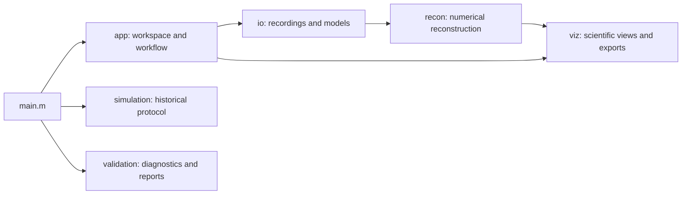

# SS-DOT GUI

A MATLAB application for short-separation diffuse optical tomography (SS-DOT), based on [Gao et al. (2023)](https://doi.org/10.1117/1.NPh.10.2.025007) and the [original SS-DOT implementation](https://github.com/YuanyuanGao216/SSDOT).

Open fNIRS recordings (SNIRF files or Homer3 results), reconstruct HbO/HbR maps, inspect signals and sensitivity, compare ROIs, and export results from one workspace.

## Requirements

- MATLAB R2026b is the documented runtime.
- Parallel Computing Toolbox and a compatible GPU are optional for GPU execution. CPU is the default.
- Signal Processing Toolbox is needed for filtering and motion-correction workflows.
- Optional external-data validation uses Python with NumPy, SciPy and h5py. The GUI itself does not require Python.

Bundled Homer3 is initialized automatically. Without the Statistics and Machine Learning Toolbox, an exact stand-in supplies the `tcdf` that Homer3's GLM uses for its p-values.

## Getting started

Open the repository folder in MATLAB and run:

```matlab
main
```

1. Click **Open dataset...** and select an included dataset (`datasets/ST001` or `datasets/ds007420`) or another compatible dataset. A dataset processed in Homer3 is read as stored; a folder of SNIRF recordings is processed with Homer3 first (see [Dataset requirements](#dataset-requirements)). The **Overview** then shows recordings, durations, channels, wavelengths, conditions and model files. No reconstruction is run.
2. Optionally review **Settings** and the compute device. Settings are remembered between sessions; **Save settings...** and **Load settings...** keep named configurations, and **Restore defaults** resets them.
3. Press **Run Analysis**. For each recording it checks the inputs, prepares sensitivity, temporal and spatial bases, reconstructs HbO/HbR and calculates the ROI for every condition. It then averages the results, with T and P values (see below). Progress and the current step are shown in the Analysis panel; **Cancel** stops at the next safe boundary and keeps completed recordings.
4. Choose a recording or an average in **Shown** and explore **Results** (HbO/HbR, T and P maps), **ROI**, **Signals** and **Model**. Changing what is shown only changes the display.

| Tab | Contents |
| --- | --- |
| Overview | Dataset summary, model-input readiness and the status of each recording |
| Signals | Stored raw intensity and optical density, with stored averages when available |
| Results | HbO/HbR maps by condition, with provenance and a fixed, automatic or custom symmetric color range (display only); for averages, **Map** also offers T and P values |
| ROI | Automatic ROIs from Run Analysis, imported ROIs, comparisons and coordinate distances |
| Model | Registered probe, sensitivity, kernel centers, the single temporal basis and the convolved temporal design over the whole recording |
| Settings | Processing steps for SNIRF recordings, reconstruction parameters, the dataset's Homer GLM timing, averages, model-input locations, ROI thresholds and figure export options |
| Log | Stage timings, activity log, technical error details and GPU check |

After the recordings, Run Analysis averages current results at every level with two or more members: a session averages its recordings, a subject its sessions and the group its subjects. A level with one member passes it on unchanged. Each average appears in the **Shown** list, for example `Average: sess01 (3 recordings)`. It also holds a per-vertex one-sample t-test of the reconstructed change against zero across its members (t = mean / (SD / sqrt(n)), df = n - 1, two-sided); choose **Map > T value** or **P value** in Results. Conditions are matched by name; a condition missing from any member is left out and named in the result description. Averaging needs no reconstruction and can be switched off under **Settings > Averages**. The P map colors vertices below the chosen significance level (default 0.05) and shows the rest in gray. P values can be shown uncorrected, FDR-adjusted (Benjamini-Hochberg) or Bonferroni-adjusted across the vertices of the map. Vertices whose values are identical in every recording have no defined t and are shown as neutral. The statistics are saved in sessions and exported with the maps.

Settings apply to the whole workspace. Changing them never discards results: existing results are marked **Out of date** until the next Run Analysis, which reuses every result whose inputs and settings are unchanged. ROI thresholds can be changed after a run; the next Run Analysis recalculates the ROIs from the existing results without repeating the reconstruction. An empty ROI (no vertex above the threshold) is a valid outcome and is reported as such.

## Dataset requirements

A dataset is a folder of SNIRF recordings with a matching AtlasViewer/forward model:

```text
dataset/
├── atlasViewer.mat
├── fw/
│   ├── Adot.mat
│   └── Adot_scalp.mat
├── sub-01/                 recordings in the folder, in subject folders,
│   └── ... SNIRF files     or in subject/session folders (BIDS sub-*/ses-*/nirs)
└── derivatives/homer/      optional: results of processing in Homer3
```

If the folder holds Homer3 results (`derivatives/homer/groupResults.mat`, as in ST001), they are used as stored. Otherwise the app processes every recording with the bundled, stock Homer3 v1.87.0 when the dataset is opened, using the steps in **Settings > Processing**. By default these are the lab's protocol used for ST001 ([processOpt_default.cfg](src/+ssdot/+homer/processOpt_default.cfg)): channel pruning, spline/Savitzky-Golay motion correction, 0-0.5 Hz band-pass, motion-based event rejection, conversion to concentration and the GLM. Every parameter can be edited there; values are kept at full precision. **Load Homer3 configuration...** uses the steps of a Homer3 `.cfg` file (a `.cfg` in the dataset folder is reported when the dataset is opened, not applied silently), and **Save as Homer3 configuration...** writes the steps for use in Homer3. Like other settings, a change marks results out of date; the next Run Analysis reprocesses the recordings and reconstructs them. Processing settings do not apply to datasets with stored Homer3 results.

Processing writes nothing into the dataset folder: results are cached under `results/` and reused while the recording, processing steps and Homer3 version are unchanged, so only the first processing takes long (about 13 s per recording, mostly motion correction). Four or more recordings are processed on parallel workers when the Parallel Computing Toolbox and free memory allow (about 1.5 GB per worker); results agree with one-at-a-time processing to rounding error. The app's processing reproduces ST001's stored Homer3 results to rounding error.

Included datasets:
- `datasets/ST001`: three recordings processed by the lab in Homer3.
- `datasets/ds007420`: the 36 ball-squeezing recordings (12 subjects) of Gao et al.'s public dataset ([OpenNeuro ds007420](https://openneuro.org/datasets/ds007420), CC0), with the forward model of a template-registered head built for this project. As in ST001, each SNIRF file holds the registered optode positions of the model; the recordings are otherwise unchanged. [buildPublicDataset.m](research/buildPublicDataset.m) rebuilds it.

Reconstruction requires continuous optical density, channel-activity metadata, task events, two wavelengths, and usable short-separation channels. Recording channels, wavelengths, probe coordinates, units and mesh ordering must match the forward model. Model discovery validates compatibility; it does not perform registration or substitute models from another dataset.

Use `SSDOT_DATA_ROOT` to change the default dataset browser location. Atlas and forward-model locations can also be selected in **Settings > Model inputs**; Run Analysis stays disabled, with the missing files listed, until they exist.

## Reconstruction

Scientific parameters remain explicit and should be selected for the acquisition and study.

The reconstruction backend uses exact temporal QR compression to avoid materializing the expanded design matrix. It retains double precision and the configured regularization objective without reducing spatial resolution.

Opening a dataset also reads the `hmrR_GLM` call in its Homer3 processing stream (time range, basis type, gamma parameters, short-separation threshold and drift order) and reports where it differs from the current settings. It is never applied automatically. Only the modified gamma basis (`idxBasis` 2) is supported by the reconstruction. The reconstruction always regresses the average of all short channels; if Homer used a different short-channel method, the Overview says so.

The temporal design uses onset impulses and configured-duration gamma smoothing. Results in older sessions computed with event-duration spreading are labelled as such. Recorded event durations remain unchanged. Current defaults are defined in [defaultConfig.m](src/+ssdot/+app/defaultConfig.m); temporal compatibility does not imply that every application setting matches the original paper's protocol.

Every reconstruction value is a Settings field, and each default reproduces the original implementation:
- separate brain and scalp log10 sensitivity mask thresholds (both -2);
- the damping factor of the optional spatial normalization (0.1);
- the time point at which maps are taken. The default samples both chromophores at the HbO basis peak; the alternative takes HbR at its own peak.

Sessions saved before a setting existed are opened with that setting's default, which is the behaviour they were computed with.

## ROI and exports

Run Analysis calculates one automatic ROI per condition with the existing `findRoi` rule on the HbO increase (or, if chosen in Settings, the HbR decrease): vertices above a fraction of the peak over the whole forward mesh that also lie in the brain sensitivity mask, plus a separate non-ROI set below a second fraction and outside an exclusion distance. The ROI viewer also supports imported ROIs and compatible side-by-side or overlay comparisons. ROIs belong to a specific mesh; forward-model and full-pial indices are not interchangeable. Coordinate distances use the selected mesh's frame and units.

**Export figures...** saves available maps, temporal bases, kernel centers and ROI views. PNG is the default; PDF and editable MATLAB FIG formats, resolution and figure size are set under **Settings > Figure export**. Exports use the color scale, colormap, P-value correction and non-ROI display currently chosen in the Results and ROI tabs. Raw/OD and probe/sensitivity views are optional. Exports use a new destination subfolder, never overwrite files and preserve the underlying numerical values. **Save session...** stores the shown recording's result, settings and ROIs; **Open session...** restores it for the matching recording and adopts its settings.

Generated caches, logs, reports and sessions are stored under ignored `results/`. Owned caches (results 7 days, Homer3 processing 30 days, each up to 2 GiB), temporary files and inactive logs have cleanup policies (empty logs of finished sessions are removed at startup); deliberate exports, saved sessions and scientific reports are retained. Original dataset files are not modified.

## Architecture



| Location | Purpose |
| --- | --- |
| `src/+ssdot/+app` | Workspace window, explicit analysis workflow and per-recording state |
| `src/+ssdot/+io` | Dataset/model adapters, ROI and session persistence |
| `src/+ssdot/+homer` | Processing SNIRF recordings with Homer3's processing stream |
| `src/+ssdot/+recon` | Numerical functions with explicit inputs and outputs |
| `src/+ssdot/+viz` | Shared plotting and figure export |
| `src/+ssdot/+simulation` | Synthetic data and historical simulation workflows |
| `src/+ssdot/+validation` | Numerical diagnostics and validation reporting |
| `external/homer3` | Stock [Homer3](https://github.com/BUNPC/Homer3) v1.87.0 (data classes and processing functions; no GUIs or sample data) |
| `external/legacy` | AtlasViewer, Homer2 and historical helpers that Homer3 does not include |
| `external/compat` | Stand-ins for toolbox functions, used only when the toolbox is missing |
| `research` | Research scripts and original-code comparison utilities |
| `tests` | Numerical, integration and GUI regression checks |

`main.m` is the single root-level MATLAB entry point. Individual package functions can also be called by adding `src` to the MATLAB path.

## Simulation and validation

```matlab
main("simulation")         % requires a configured simulation input bundle
main("validation")         % runs the validation/reporting workflow
```

Historical simulation requires separately supplied compatible reference recordings, resting data, forward models and stimulus sequences. Set `SSDOT_SIMULATION_INPUT_ROOT` or pass explicit paths to `ssdot.simulation.runStudy(options)`. The included experimental dataset is not a replacement for these inputs.

`main("validation")` runs the research reporting workflow (ST001 diagnostics, known-source simulations and optional public benchmarks); it is intentionally not part of the analysis workspace. Reports use HTML with MAT/CSV/JSON numerical outputs. External recordings require compatible models and their own usage permissions; keep downloaded datasets outside Git unless their license allows redistribution, as ds007420's does. Numerical agreement is distinct from physiological or anatomical validation.

## Development

The suite runs in under ten seconds in an open MATLAB session (the first run in a new session also pays MATLAB's one-time graphics start-up):

```matlab
results = runtests("tests", "IncludeSubfolders", true);
assertSuccess(results);
assert(all([results.Passed]));
```

The suite covers the solver against a direct least-squares calculation of the physical model, ST001 against captured reference outputs, Homer3 processing in the app against ST001's stored Homer3 results, statistics, ROI rules, settings, runtime retention, and the window with synthetic results. The temporal reference was captured from the professor's pinned Homer code by [captureTestFixtures.m](research/captureTestFixtures.m), so the suite does not need that repository. GPU execution is checked in the app with **Log > Check GPU**. Full-resolution and public-data runs are research workflows (`main("validation")`), not tests.

## Reference and license

Gao, Y. et al. (2023). *Short-separation regression incorporated diffuse optical tomography image reconstruction modeling for high-density functional near-infrared spectroscopy.* Neurophotonics, 10(2), 025007. [Paper](https://doi.org/10.1117/1.NPh.10.2.025007) · [Original code](https://github.com/YuanyuanGao216/SSDOT).

SS-DOT is distributed under the [MIT license](LICENSE), copyright © 2022 Yuanyuan Gao. This GUI builds on the original research implementation and subsequent student contributions.

Bundled Homer3 code retains its own copyright and redistribution notices: see [its license](external/homer3/LICENSE.txt) and the notices in files such as [GetExtinctions.m](external/homer3/FuncRegistry/UserFunctions/GetExtinctions.m). The historical simulation keeps the earlier, locally modified Homer processing functions it was validated with in [src/+ssdot/+io/private](src/+ssdot/+io/private), where only its preprocessing code can see them. Those dependency terms remain applicable independently of the project license.
