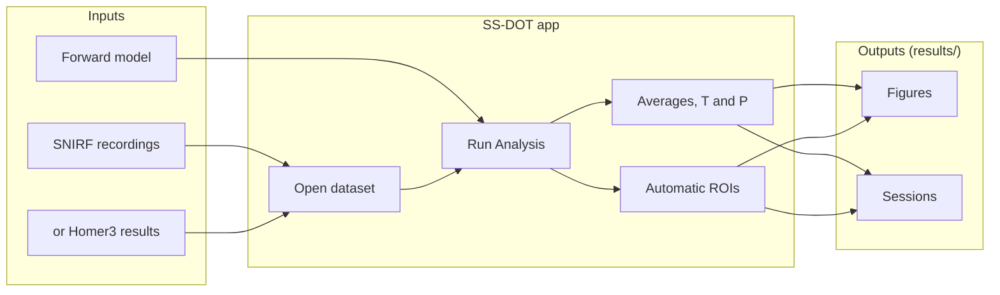
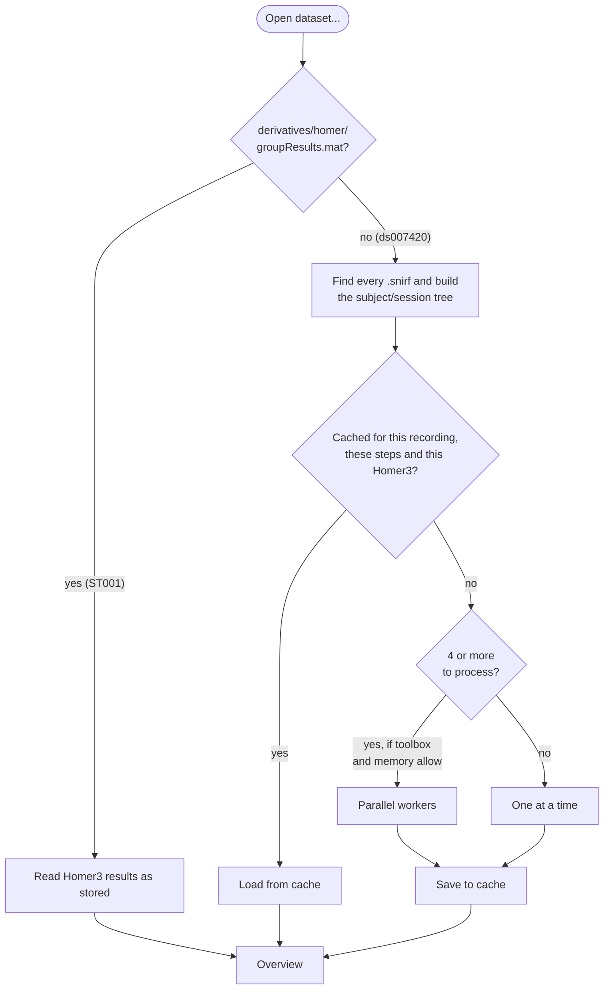
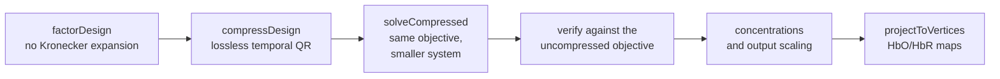
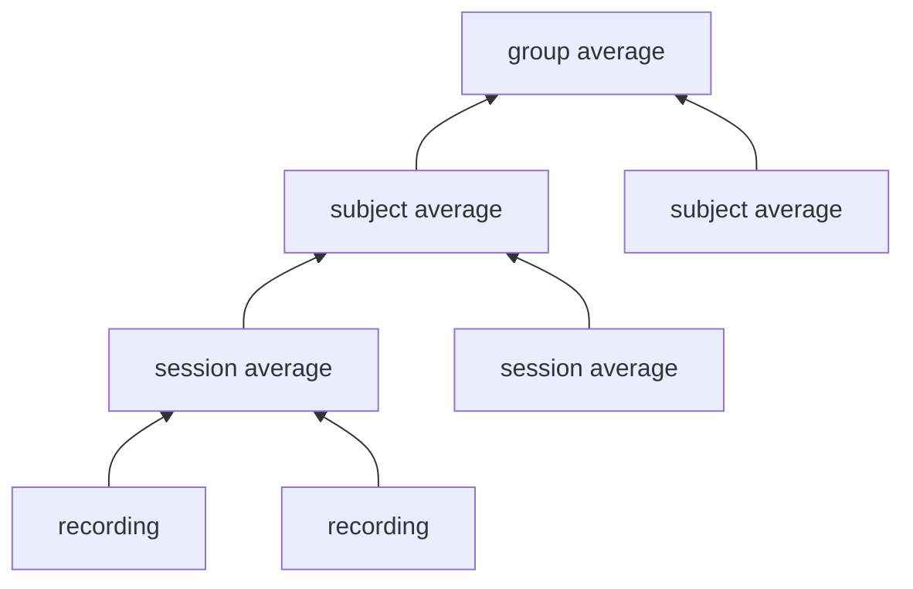
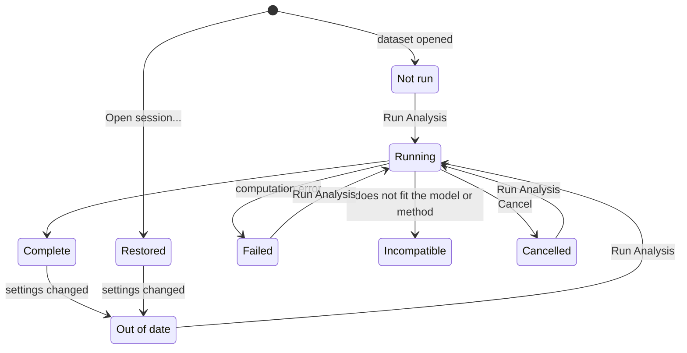
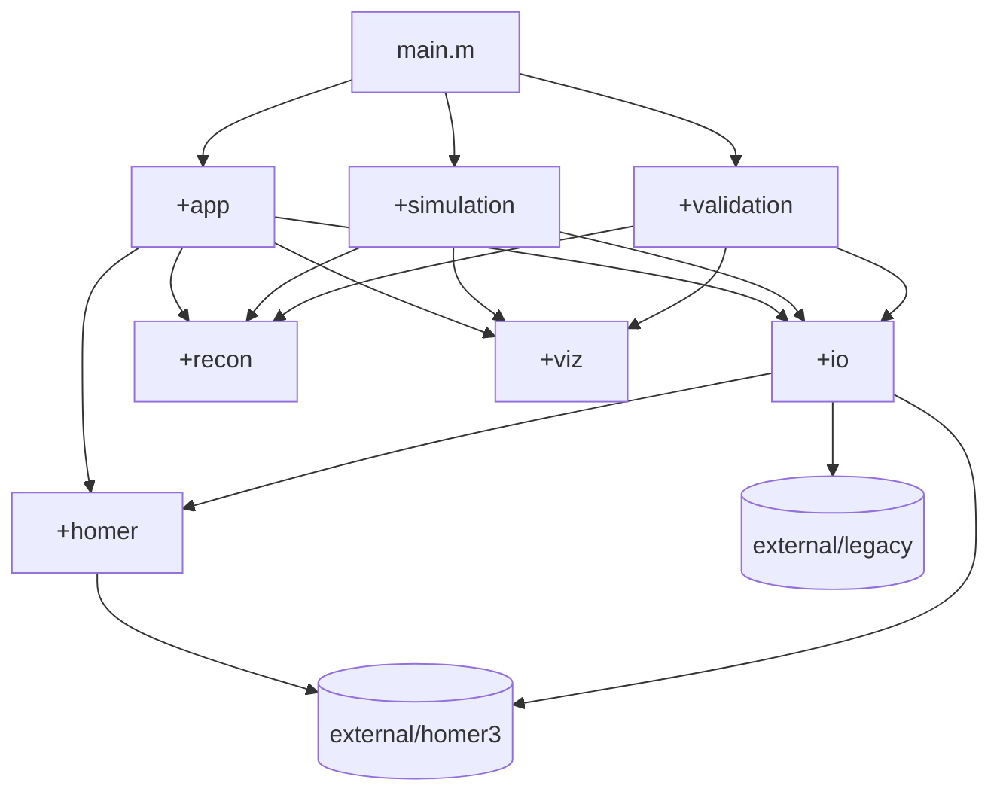
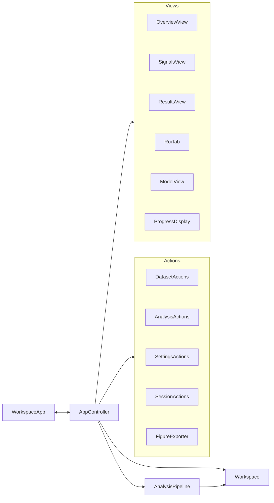

# SS-DOT GUI

A MATLAB application for **short-separation diffuse optical tomography (SS-DOT)**, based on [Gao et al. (2023)](https://doi.org/10.1117/1.NPh.10.2.025007) and the [original SS-DOT implementation](https://github.com/YuanyuanGao216/SSDOT). It turns fNIRS recordings into HbO/HbR brain maps in one window.

```matlab
main          % open the app
```

## Contents

1. [Quick start](#quick-start)
2. [Glossary](#glossary)
3. [What it can do](#what-it-can-do)
4. [How it works](#how-it-works): [overview](#overview) · [opening a dataset](#opening-a-dataset) · [Run Analysis](#run-analysis) · [the reconstruction](#the-reconstruction) · [averages](#averages-t-and-p-maps) · [result status](#result-status)
5. [The window](#the-window)
6. [Datasets](#datasets)
7. [Settings](#settings)
8. [ROIs, sessions and exports](#rois-sessions-and-exports)
9. [Files the app writes](#files-the-app-writes)
10. [Architecture](#architecture)
11. [Repository map](#repository-map)
12. [Simulation and validation modes](#simulation-and-validation-modes)
13. [Development and tests](#development-and-tests)
14. [Reference and license](#reference-and-license)

---

## Quick start

| Need | For |
| --- | --- |
| MATLAB R2026b | Everything (the documented runtime) |
| Signal Processing Toolbox | Filtering and motion correction |
| Parallel Computing Toolbox *(optional)* | GPU reconstruction and parallel Homer3 processing |
| A compatible GPU *(optional)* | GPU reconstruction; CPU is the default |
| Statistics and Machine Learning Toolbox *(optional)* | Nothing: without it, an exact stand-in supplies the `tcdf` that Homer3's GLM uses |
| Python with NumPy, SciPy, h5py *(optional)* | Only the external-data validation scripts |

Homer3 is bundled and set up automatically. Open the repository folder in MATLAB, run `main`, then:

1. **Open dataset...** and choose `datasets/ST001` or `datasets/ds007420` ([included datasets](#included-datasets)).
2. *(Optional)* review **Settings** and the compute device.
3. Press **Run Analysis**.
4. Choose a recording or an average in **Shown** and explore the tabs.
5. **Export figures...** or **Save session...** to keep what you see.

---

## Glossary

| Term | Meaning |
| --- | --- |
| **fNIRS** | Functional near-infrared spectroscopy: light sources and detectors on the scalp measure blood-oxygen changes in the cortex. |
| **SNIRF** | The standard fNIRS file format (`.snirf`, HDF5): raw light intensity, probe geometry and task events of one recording. |
| **Homer3** | A MATLAB toolbox from Boston University that processes fNIRS signals: pruning, motion correction, filtering, conversion to concentration, GLM. |
| **Processing stream** | The ordered Homer3 steps and their parameters, stored in a Homer3 `.cfg` file. |
| **OD** | Optical density: the log change in light intensity. It is the input to the reconstruction. |
| **HbO / HbR** | Oxygenated and deoxygenated hemoglobin concentration changes. |
| **Short-separation channel** | A source-detector pair a few mm apart that sees only the scalp. SS-DOT regresses these signals out with the image instead of beforehand. |
| **Forward model** | Light-sensitivity matrices (`fw/Adot.mat` brain, `fw/Adot_scalp.mat` scalp): how much each mesh vertex affects each channel. |
| **AtlasViewer** | The tool that registers the probe to a head model; `atlasViewer.mat` holds the meshes and registered probe. |
| **Temporal basis** | Gamma-shaped response functions convolved with event onsets: the expected time course of activation. |
| **Spatial basis** | Gaussian kernels over the brain and scalp meshes; the image is a weighted sum of them. |
| **ROI** | Region of interest: the mesh vertices selected as activated. |
| **T / P map** | Per-vertex one-sample t-test across the members of an average, and its p-values. |

---

## What it can do

- **Open SNIRF folders or Homer3 results:** SNIRF recordings are processed with bundled stock Homer3 v1.87.0, cached and run in parallel; Homer3 results are read as stored. [More](#opening-a-dataset)
- **Reconstruct HbO/HbR maps:** one Run Analysis covers every recording and condition, reuses unchanged results and can be cancelled safely. [More](#run-analysis)
- **Keep exact precision:** the compressed solver keeps double precision and full resolution, and checks every result against the uncompressed problem. [More](#the-reconstruction)
- **Average with statistics:** session, subject and group averages, with T and P maps (uncorrected, FDR or Bonferroni). [More](#averages-t-and-p-maps)
- **Find ROIs:** automatic ROIs per condition, imported ROIs and comparisons. [More](#rois-sessions-and-exports)
- **Edit Homer3 steps:** edit the processing steps and exchange them with Homer3 as `.cfg` files. [More](#settings)
- **Keep your work:** figure export, sessions and named settings files. [More](#rois-sessions-and-exports)
- **Leave inputs alone:** nothing is ever written into a dataset folder. [More](#files-the-app-writes)

---

## How it works

### Overview



Nothing is reconstructed until **Run Analysis**. Choosing what to show only changes the display.

### Opening a dataset



- **Steps used:** those in [Settings > Processing](#settings). By default this is the lab's protocol for ST001 ([processOpt_default.cfg](src/+ssdot/+homer/processOpt_default.cfg)):
  1. channel pruning;
  2. intensity to OD;
  3. spline/Savitzky-Golay motion correction;
  4. 0–0.5 Hz band-pass filter;
  5. motion-based event rejection;
  6. conversion to concentration;
  7. the GLM.
- **A `.cfg` in the dataset folder** is mentioned when the dataset opens, but never applied silently.
- **Time:** about 13 s per recording the first time, mostly motion correction. Each parallel worker needs about 1.5 GB of memory. ds007420's 36 recordings take about 3.5 minutes on 3 workers; later openings read the cache.
- **Equivalence:** the app's processing reproduces ST001's stored Homer3 results to rounding error (about 1e-13), and parallel processing matches serial.

### Run Analysis

Run Analysis first reprocesses any recording whose processing steps changed. It then brings each recording up to date in eight stages:

| Stage | What happens | Code |
| --- | --- | --- |
| 1 Check inputs | Reads recording and model files; checks channels, wavelengths, probe and mesh match | [checkWorkflowInputs.m](src/+ssdot/+io/checkWorkflowInputs.m) |
| 2 Prepare sensitivity | Selects measurements, applies brain/scalp sensitivity masks and normalization | [prepareSensitivity.m](src/+ssdot/+recon/prepareSensitivity.m) |
| 3 Temporal design | Gamma basis functions convolved with each condition's onsets | [buildTemporalBasis.m](src/+ssdot/+recon/buildTemporalBasis.m) |
| 4 Memory check | Stops early if the chosen device lacks memory | [estimateResources.m](src/+ssdot/+app/estimateResources.m) |
| 5 Spatial bases | Gaussian kernels over downsampled brain and scalp vertices | [buildSpatialBasis.m](src/+ssdot/+recon/buildSpatialBasis.m) |
| 6 Observations | Long-channel OD with short-separation and drift regressors | [buildObservations.m](src/+ssdot/+recon/buildObservations.m) |
| 7 Reconstruction | The [solver](#the-reconstruction) | [reconstructImage.m](src/+ssdot/+recon/reconstructImage.m) |
| 8 ROI | Automatic ROI and non-ROI sets for every condition | [findRoi.m](src/+ssdot/+recon/findRoi.m) |

- **Reuse:** a recording whose inputs and settings are unchanged keeps its result, and a changed ROI threshold reruns only stage 8.
- **Averages:** computed after the recordings ([below](#averages-t-and-p-maps)).
- **Progress:** the Analysis panel shows the current stage, and the Log tab times each one.
- **Cancel:** stops at the next safe boundary and keeps completed recordings.

### The reconstruction

The SS-DOT model fits the image, the short-separation signals and drift together. Written out in full, the design (channels × time × kernels) would not fit in memory, so the solver keeps it factored and compresses it exactly:



- **Precision:** double precision, the configured regularization objective and full spatial resolution.
- **Verification:** a result that does not match the uncompressed objective within a data-scaled roundoff bound is rejected ([verifyObjectiveAgreement.m](src/+ssdot/+recon/verifyObjectiveAgreement.m)).
- **Defaults:** every value is a setting, and each default reproduces the original implementation ([defaultConfig.m](src/+ssdot/+app/defaultConfig.m)):
  - brain and scalp log10 sensitivity thresholds of −2;
  - normalization damping of 0.1;
  - both maps taken at the HbO basis peak. The alternative takes HbR at its own peak.
- **Temporal design:** onset impulses with gamma smoothing over a configured duration. Recorded event durations are unchanged. Older sessions computed with event-duration spreading are labelled as such.
- **Homer GLM settings:** the Overview compares the dataset's stored `hmrR_GLM` settings (time range, basis, gamma parameters, short-separation threshold, drift order) with the current settings. They are never applied automatically.
- **Supported basis:** only the modified gamma basis (`idxBasis` 2).
- **Short channels:** the average of all short channels is always regressed. If Homer used another method, the Overview says so.
- **Older sessions:** a setting that didn't exist yet opens with its default, which is how those sessions were computed.

### Averages, T and P maps



- **Levels:** every level with two or more members is averaged; a level with one member passes it on unchanged. Averages appear in **Shown**, for example `Average: sess01 (3 recordings)`.
- **Conditions** are matched by name. A condition missing from any member is left out and named in the description.
- **T values:** per vertex, t = mean / (SD / √n), df = n − 1, two-sided, testing the change against zero ([groupStatistics.m](src/+ssdot/+recon/groupStatistics.m)).
- **P maps:** vertices below the significance level (default 0.05) are colored and the rest gray. P values can be uncorrected, FDR-adjusted (Benjamini-Hochberg) or Bonferroni-adjusted across the map ([adjustPValues.m](src/+ssdot/+recon/adjustPValues.m)).
- **Undefined t:** a vertex identical in every member has no defined t and is shown as neutral.
- **Cost:** averaging needs no reconstruction.
- **Saving:** statistics are saved in sessions and included in exports.

### Result status



Changing settings never discards a result: it stays visible, marked **Out of date**, until Run Analysis replaces it.

---

## The window

The Analysis panel on the left has **Shown** (the recording or average to display), the compute device, **Run Analysis**, **Cancel** and progress. The header has **Open dataset...**, **Open session...**, **Save session...** and **Export figures...**. The tabs:

| Tab | Contents |
| --- | --- |
| **Overview** | Dataset summary, processing source, model-input readiness and the status of each recording |
| **Signals** | Raw intensity and OD for one channel, with event markers and stored averages when available |
| **Results** | HbO/HbR maps by condition with provenance. For averages, **Map** also offers T and P values with the significance level and correction. Color scale and colormap affect only the display |
| **ROI** | Automatic and imported ROIs, side-by-side or overlay comparisons, coordinate distances |
| **Model** | Registered probe, sensitivity, kernel centers, temporal basis and the convolved design over the recording |
| **Settings** | See [Settings](#settings) |
| **Log** | Stage timings, activity log, technical error details and **Check GPU** |

---

## Datasets

```text
dataset/
├── atlasViewer.mat            head meshes and registered probe
├── fw/
│   ├── Adot.mat               brain sensitivity
│   └── Adot_scalp.mat         scalp sensitivity
├── *.snirf                    recordings directly here (one subject),
├── sub-01/*.snirf             in subject folders,
├── sub-02/ses-1/nirs/*.snirf  or in subject/session folders (BIDS nirs folders are skipped)
├── *.cfg                      optional Homer3 configuration (reported, not applied)
└── derivatives/homer/         optional Homer3 results (then used as stored; otherwise ignored)
```

**Requirements:**
- **Signals:** continuous OD, channel-activity metadata, task events, two wavelengths and usable short-separation channels.
- **Matching the model:** channels, wavelengths, probe coordinates, units and mesh ordering must match the forward model.
- **Registration:** the app checks compatibility. It never registers a probe or substitutes another dataset's model.
- **Model elsewhere:** if the model files are not in the dataset folder, choose them in **Settings > Model inputs**. Until they exist, Run Analysis stays disabled and lists what is missing.

### Included datasets

| | `datasets/ST001` | `datasets/ds007420` |
| --- | --- | --- |
| **Recordings** | 3, one session, from the lab | 36 ball-squeezing runs, 12 subjects × 3, from Gao et al.'s public [OpenNeuro ds007420](https://openneuro.org/datasets/ds007420) |
| **Processing** | By the lab in Homer3 v1.87 (`derivatives/homer/`), read as stored | By the app on opening |
| **Forward model** | The lab's AtlasViewer model (`fw/`, `imagerecon/`, `atlasViewer.mat`) | Built for this project on a template-registered head (`fw/`, `atlasViewer.mat`) |
| **Probe** | Registered positions in the SNIRF files | Registered positions written into the SNIRF files; otherwise unchanged |
| **Also contains** | `processOpt_Gao.cfg` (the lab's Homer3 steps), a screenshot of the original setup | `provenance.json` (source version, model hash, changes) |
| **License** | Lab data | CC0 |
| **Rebuilt by** | — | [buildPublicDataset.m](research/buildPublicDataset.m) |

---

## Settings

Settings apply to the whole workspace and are remembered between sessions. **Save settings...**, **Load settings...** and **Restore defaults** manage them.

| Section | Controls |
| --- | --- |
| **Processing** | The Homer3 steps for SNIRF recordings, one row per parameter, kept at full precision. **Load Homer3 configuration...** and **Save as Homer3 configuration...** read and write `.cfg` files. These steps don't affect datasets with stored Homer3 results. |
| **Reconstruction** | Kernel spacing (sampling thresholds) and widths (sigma), sensitivity thresholds, long/short channel separations, drift order, alpha, beta, regularization (standard or noise weighted), spatial normalization and damping, map time point, temporal range and basis parameters |
| **Averages** | Whether to average at all |
| **Model inputs** | Atlas file and forward-model folder (default: the opened dataset) |
| **ROI** | ROI signal (HbO increase or HbR decrease), ROI and non-ROI fractions of the peak, exclusion distance. A change recalculates ROIs without reconstructing. |
| **Figure export** | Format (PNG, PDF or FIG), resolution, size and which views to include |

The compute device (CPU or GPU) is in the Analysis panel. **Log > Check GPU** tests it.

---

## ROIs, sessions and exports

**ROIs**
- **Rule:** one automatic ROI per condition, using the original `findRoi` rule. ROI vertices are above a fraction of the peak over the whole forward mesh and inside the brain sensitivity mask.
- **Non-ROI set:** vertices below a second fraction and outside an exclusion distance.
- **Empty ROIs:** a valid outcome, reported as such.
- **Meshes:** an ROI belongs to one mesh, so forward-model and full-pial indices never mix. Distances use that mesh's frame and units.

**Exports and sessions**
- **Export figures:** saves maps, temporal bases, kernel centers and ROI views into a new folder with a JSON manifest. Raw/OD and probe/sensitivity views are optional. Exports follow the color scale, colormap, P-value correction and non-ROI display chosen on screen. Files are never overwritten, and the numbers are kept unchanged.
- **Sessions:** **Save session...** stores the shown result, its settings and ROIs as versioned plain data. **Open session...** restores it for the matching recording and adopts its settings.

---

## Files the app writes

Everything generated goes under `results/`, which Git ignores. [cleanRuntime.m](src/+ssdot/+io/cleanRuntime.m) applies the retention rules at startup.

| Folder | Contents | Kept |
| --- | --- | --- |
| `results/settings.mat` | Remembered settings | Always |
| `results/cache/v2/` | Reconstruction results; Homer3 processing (`ssdot-homer-v1-*.mat`) | 7 days / 30 days, each up to 2 GiB |
| `results/temporary/v2/` | Scratch files | 1 day |
| `results/logs/` | Session logs | Inactive logs are cleaned up; empty ones are removed |
| `results/sessions/`, `results/figures/` | Saved sessions and exports | Until you delete them |
| `results/validation/`, `compatibility/`, `experiments/` | Research reports and evidence | Until you delete them |

---

## Architecture

### Packages

All code is in the `ssdot` package under `src/`. Arrows mean "calls".



**Rules that keep it organized**
- **`+recon`** is pure numerics: explicit inputs and outputs, no files and no user interface. The numerical tests exercise it directly.
- **`+io`** is the only layer that reads or writes files, and it never writes into a dataset.
- **`+homer`** runs Homer3 processing streams. Outside it, only `+io` adapters such as [nodeChildren.m](src/+ssdot/+io/nodeChildren.m) and [isRecording.m](src/+ssdot/+io/isRecording.m) know Homer's data structures.
- **`+viz`** draws data it is given and never runs an analysis.
- **`+app`** owns the user interface and state, and contains no numerics.

### Inside the app



- **Actions** respond to buttons and change state; **views** draw it.
- **`Workspace` and `AnalysisPipeline` have no user interface.** They report through callbacks the controller connects, so tests can drive them without a window.

---

## Repository map

```text
neuroimaging-ssdot-gui/
├── main.m          the only entry point: main, main("simulation"), main("validation")
├── src/+ssdot/     the application and its libraries (tables below)
├── external/       third-party code
├── datasets/       ST001 and ds007420 (see Included datasets)
├── tests/          the test suite (see Development and tests)
├── research/       scripts run by hand
├── results/        generated output, ignored by Git (see Files the app writes)
├── README.md
└── LICENSE         MIT
```

**Why `src` and `research` are separate:** `src` is what the app and the tests rely on. `research` holds scripts run by hand to answer one question, such as reproducing a figure, comparing with the professor's code or building a dataset. Nothing in `src` calls them.

### `src/+ssdot/+app`: the window and the workflow

| File | Purpose |
| --- | --- |
| [WorkspaceApp.m](src/+ssdot/+app/WorkspaceApp.m) | The window and its controls |
| [AppController.m](src/+ssdot/+app/AppController.m) | Wires window, workspace, pipeline, actions and views; busy state, cancellation, errors, log |
| [Workspace.m](src/+ssdot/+app/Workspace.m) | The opened dataset, per-recording states, settings, averaging, statuses, settings files |
| [ReconstructionState.m](src/+ssdot/+app/ReconstructionState.m) | One recording's inputs, prepared stages, result, ROIs and status |
| [AnalysisPipeline.m](src/+ssdot/+app/AnalysisPipeline.m) | The eight stages for one recording |
| [DatasetActions.m](src/+ssdot/+app/DatasetActions.m) | Open a dataset; choose what is shown |
| [AnalysisActions.m](src/+ssdot/+app/AnalysisActions.m) | Run Analysis, Cancel, ROI updates, loading a model to view |
| [SettingsActions.m](src/+ssdot/+app/SettingsActions.m) | Settings tab, compute device, processing steps |
| [SessionActions.m](src/+ssdot/+app/SessionActions.m) | Save and open sessions |
| [FigureExporter.m](src/+ssdot/+app/FigureExporter.m) | Figure export with a manifest |
| [OverviewView.m](src/+ssdot/+app/OverviewView.m), [SignalsView.m](src/+ssdot/+app/SignalsView.m), [ResultsView.m](src/+ssdot/+app/ResultsView.m), [ModelView.m](src/+ssdot/+app/ModelView.m) | One tab each |
| [RoiTab.m](src/+ssdot/+app/RoiTab.m), [RoiViewer.m](src/+ssdot/+app/RoiViewer.m) | ROI tab and its viewer |
| [ProgressDisplay.m](src/+ssdot/+app/ProgressDisplay.m) | Stage, step, gauge, clock and errors |
| [launchGui.m](src/+ssdot/+app/launchGui.m), [initializeEnvironment.m](src/+ssdot/+app/initializeEnvironment.m) | Start-up: paths (Homer3, legacy, compat), data root, cleanup |
| [projectRoot.m](src/+ssdot/+app/projectRoot.m), [runtimePaths.m](src/+ssdot/+app/runtimePaths.m) | The checkout and its `results/` folders |
| [defaultConfig.m](src/+ssdot/+app/defaultConfig.m), [completeConfig.m](src/+ssdot/+app/completeConfig.m), [validateConfig.m](src/+ssdot/+app/validateConfig.m) | Default settings; filling in older ones; rejecting invalid ones |
| [scientificConfig.m](src/+ssdot/+app/scientificConfig.m), [sameConfig.m](src/+ssdot/+app/sameConfig.m) | Settings that affect results, and comparing them |
| [defaultRoiSettings.m](src/+ssdot/+app/defaultRoiSettings.m), [validateRoiSettings.m](src/+ssdot/+app/validateRoiSettings.m) | ROI threshold defaults and checks |
| [conditionNames.m](src/+ssdot/+app/conditionNames.m), [matchConditions.m](src/+ssdot/+app/matchConditions.m) | Condition names; conditions shared by an average's members |
| [describeRecording.m](src/+ssdot/+app/describeRecording.m), [summarizeHomerGlm.m](src/+ssdot/+app/summarizeHomerGlm.m) | Overview text for a recording and its stored GLM settings |
| [estimateResources.m](src/+ssdot/+app/estimateResources.m), [gpuDiagnostics.m](src/+ssdot/+app/gpuDiagnostics.m) | Memory estimate; GPU checks |
| [fileDialogs.m](src/+ssdot/+app/fileDialogs.m) | File choosers (replaced by fakes in tests) |

### `src/+ssdot/+homer`: Homer3 processing of SNIRF folders

| File | Purpose |
| --- | --- |
| [openDataset.m](src/+ssdot/+homer/openDataset.m) | Finds SNIRF files and builds the subject/session tree |
| [updateProcessing.m](src/+ssdot/+homer/updateProcessing.m) | Cache lookup, serial or parallel processing, atomic cache writes |
| [processRun.m](src/+ssdot/+homer/processRun.m) | Runs a stream on one recording, as Homer3's `RunClass.Calc` does |
| [DatasetNode.m](src/+ssdot/+homer/DatasetNode.m) | A group, subject, session or recording (stands in for Homer3's tree classes) |
| [groupConditions.m](src/+ssdot/+homer/groupConditions.m) | Events padded to the group's conditions |
| [parseStream.m](src/+ssdot/+homer/parseStream.m), [readProcessingStream.m](src/+ssdot/+homer/readProcessingStream.m), [writeConfiguration.m](src/+ssdot/+homer/writeConfiguration.m) | Streams from call lines, from a `.cfg`, and back to a `.cfg` |
| [setParameter.m](src/+ssdot/+homer/setParameter.m) | Replaces one parameter at full precision |
| [defaultStream.m](src/+ssdot/+homer/defaultStream.m), [processOpt_default.cfg](src/+ssdot/+homer/processOpt_default.cfg) | The default steps (a copy of ST001's `processOpt_Gao.cfg`) |

### `src/+ssdot/+io`: reading and writing

| File | Purpose |
| --- | --- |
| **Datasets and recordings** | |
| [loadDataset.m](src/+ssdot/+io/loadDataset.m) | Opens stored Homer3 results, or hands SNIRF folders to `+homer` |
| [nodeChildren.m](src/+ssdot/+io/nodeChildren.m), [isRecording.m](src/+ssdot/+io/isRecording.m), [recordingFiles.m](src/+ssdot/+io/recordingFiles.m) | Walking either kind of dataset tree |
| [readRecording.m](src/+ssdot/+io/readRecording.m), [readRun.m](src/+ssdot/+io/readRun.m), [readStimuli.m](src/+ssdot/+io/readStimuli.m) | Raw SNIRF data; a processed recording as reconstruction inputs; events |
| [recordingProbe.m](src/+ssdot/+io/recordingProbe.m), [reorderMeasurements.m](src/+ssdot/+io/reorderMeasurements.m) | Probe with units; channel reordering to match a reference |
| [extractTimeSeries.m](src/+ssdot/+io/extractTimeSeries.m), [signalRepresentation.m](src/+ssdot/+io/signalRepresentation.m) | Stored signals for plotting |
| [readHomerGlm.m](src/+ssdot/+io/readHomerGlm.m), [processHomerGlm.m](src/+ssdot/+io/processHomerGlm.m) | Stored GLM parameters; the GLM with its design matrix |
| [preprocessHomer.m](src/+ssdot/+io/preprocessHomer.m), [preprocessRecording.m](src/+ssdot/+io/preprocessRecording.m) | The historical simulation's preprocessing |
| [private/](src/+ssdot/+io/private) | The locally modified Homer functions the simulation was validated with. Only `+io` sees them, so the app uses stock Homer3. |
| **Models and meshes** | |
| [loadAtlas.m](src/+ssdot/+io/loadAtlas.m), [atlasProbe.m](src/+ssdot/+io/atlasProbe.m) | `atlasViewer.mat` and its registered probe |
| [loadForwardModel.m](src/+ssdot/+io/loadForwardModel.m), [loadSensitivity.m](src/+ssdot/+io/loadSensitivity.m) | Sensitivities |
| [checkWorkflowInputs.m](src/+ssdot/+io/checkWorkflowInputs.m), [assertCompatibleProbe.m](src/+ssdot/+io/assertCompatibleProbe.m) | Input checks before computation |
| [surfaceFromAtlas.m](src/+ssdot/+io/surfaceFromAtlas.m), [meshIdentity.m](src/+ssdot/+io/meshIdentity.m) | One mesh and its hash |
| **ROIs and sessions** | |
| [readRoi.m](src/+ssdot/+io/readRoi.m), [saveRoi.m](src/+ssdot/+io/saveRoi.m), [roiFromIndices.m](src/+ssdot/+io/roiFromIndices.m), [validateDatasetRois.m](src/+ssdot/+io/validateDatasetRois.m) | ROI files tied to a mesh |
| [saveSession.m](src/+ssdot/+io/saveSession.m), [readSession.m](src/+ssdot/+io/readSession.m), [restoreSession.m](src/+ssdot/+io/restoreSession.m) | Session files |
| **Caches, hashes and exports** | |
| [SharedCache.m](src/+ssdot/+io/SharedCache.m), [fileHash.m](src/+ssdot/+io/fileHash.m), [valueHash.m](src/+ssdot/+io/valueHash.m) | In-memory cache; SHA-256 identities |
| [cleanRuntime.m](src/+ssdot/+io/cleanRuntime.m) | Retention for `results/` |
| [createFigureExportFolder.m](src/+ssdot/+io/createFigureExportFolder.m), [writeFigureManifest.m](src/+ssdot/+io/writeFigureManifest.m) | Export folder and manifest |

### `src/+ssdot/+recon`: the numerical reconstruction

| File | Purpose |
| --- | --- |
| **Sensitivity and spatial basis** | |
| [prepareSensitivity.m](src/+ssdot/+recon/prepareSensitivity.m), [buildSensitivityMask.m](src/+ssdot/+recon/buildSensitivityMask.m), [buildForwardMatrix.m](src/+ssdot/+recon/buildForwardMatrix.m) | Measurement selection, masks, forward matrices |
| [downsampleVertices.m](src/+ssdot/+recon/downsampleVertices.m), [buildGaussianKernels.m](src/+ssdot/+recon/buildGaussianKernels.m), [buildSpatialBasis.m](src/+ssdot/+recon/buildSpatialBasis.m) | Kernel centers and Gaussian kernels |
| **Temporal design and observations** | |
| [buildTemporalBasis.m](src/+ssdot/+recon/buildTemporalBasis.m), [constructBasisFunctions.m](src/+ssdot/+recon/constructBasisFunctions.m), [constructTemporalDesign.m](src/+ssdot/+recon/constructTemporalDesign.m), [buildTemporalMatrix.m](src/+ssdot/+recon/buildTemporalMatrix.m) | Homer GLM basis functions convolved with onsets |
| [buildObservations.m](src/+ssdot/+recon/buildObservations.m), [buildDriftMatrix.m](src/+ssdot/+recon/buildDriftMatrix.m) | OD with short-separation and drift regressors |
| [intensityToOd.m](src/+ssdot/+recon/intensityToOd.m), [activeMeasurements.m](src/+ssdot/+recon/activeMeasurements.m), [validateMeasurementLayout.m](src/+ssdot/+recon/validateMeasurementLayout.m), [measurementPrecision.m](src/+ssdot/+recon/measurementPrecision.m) | OD, channel masks, wavelength layout, noise weights |
| **Solver** | |
| [reconstructImage.m](src/+ssdot/+recon/reconstructImage.m) | Entry point: solve, verify, project |
| [factorDesign.m](src/+ssdot/+recon/factorDesign.m), [applyFactorizedDesign.m](src/+ssdot/+recon/applyFactorizedDesign.m) | The design kept factored, and applied without forming it |
| [compressDesign.m](src/+ssdot/+recon/compressDesign.m), [solveCompressed.m](src/+ssdot/+recon/solveCompressed.m), [verifyObjectiveAgreement.m](src/+ssdot/+recon/verifyObjectiveAgreement.m) | Compression, solve, check |
| [reconstructConcentrations.m](src/+ssdot/+recon/reconstructConcentrations.m), [applyOutputScaling.m](src/+ssdot/+recon/applyOutputScaling.m), [projectToVertices.m](src/+ssdot/+recon/projectToVertices.m) | Concentrations and maps |
| [resolveDevice.m](src/+ssdot/+recon/resolveDevice.m) | CPU/GPU validation; never switches silently |
| **After the reconstruction** | |
| [averageResults.m](src/+ssdot/+recon/averageResults.m), [groupStatistics.m](src/+ssdot/+recon/groupStatistics.m), [adjustPValues.m](src/+ssdot/+recon/adjustPValues.m) | Averages, t-tests, corrections |
| [findRoi.m](src/+ssdot/+recon/findRoi.m), [coordinateDistance.m](src/+ssdot/+recon/coordinateDistance.m) | ROI rule; distances |

### `src/+ssdot/+viz`: plots and figure export

| File | Purpose |
| --- | --- |
| [plotSurface.m](src/+ssdot/+viz/plotSurface.m) | The shared surface renderer |
| [plotReconstruction.m](src/+ssdot/+viz/plotReconstruction.m), [plotIntensity.m](src/+ssdot/+viz/plotIntensity.m), [statisticDisplay.m](src/+ssdot/+viz/statisticDisplay.m), [mapColormap.m](src/+ssdot/+viz/mapColormap.m) | Result, T and P maps |
| [plotBrainSurface.m](src/+ssdot/+viz/plotBrainSurface.m), [plotHeadSurface.m](src/+ssdot/+viz/plotHeadSurface.m), [plotProbe.m](src/+ssdot/+viz/plotProbe.m), [plotSensitivity.m](src/+ssdot/+viz/plotSensitivity.m), [plotKernelCenters.m](src/+ssdot/+viz/plotKernelCenters.m) | Model views |
| [plotTemporalBasis.m](src/+ssdot/+viz/plotTemporalBasis.m), [plotTemporalDesign.m](src/+ssdot/+viz/plotTemporalDesign.m), [plotSignals.m](src/+ssdot/+viz/plotSignals.m), [plotStimuli.m](src/+ssdot/+viz/plotStimuli.m) | Time courses and events |
| [plotRoi.m](src/+ssdot/+viz/plotRoi.m), [plotRoiComparison.m](src/+ssdot/+viz/plotRoiComparison.m), [validateRoi.m](src/+ssdot/+viz/validateRoi.m), [validateSurface.m](src/+ssdot/+viz/validateSurface.m) | ROI views and input checks |
| [exportFigures.m](src/+ssdot/+viz/exportFigures.m), [styleExport.m](src/+ssdot/+viz/styleExport.m) | Saving figures |
| [plotHemoglobin.m](src/+ssdot/+viz/plotHemoglobin.m), [plotStudyCurves.m](src/+ssdot/+viz/plotStudyCurves.m) | Figures for research scripts and the simulation |

### `src/+ssdot/+simulation`: the historical simulation study

| File | Purpose |
| --- | --- |
| [runStudy.m](src/+ssdot/+simulation/runStudy.m), [validateInputs.m](src/+ssdot/+simulation/validateInputs.m) | Entry point and input checks |
| [simulatePerturbation.m](src/+ssdot/+simulation/simulatePerturbation.m) | Adds a simulated motor response to resting recordings |
| [runLegacyPipeline.m](src/+ssdot/+simulation/runLegacyPipeline.m), [reconstructStudy.m](src/+ssdot/+simulation/reconstructStudy.m) | Historical design and reconstruction of every subject |
| [calculateCnr.m](src/+ssdot/+simulation/calculateCnr.m), [evaluatePerformance.m](src/+ssdot/+simulation/evaluatePerformance.m) | CNR, t values, laterality, localization error |
| [summarizeSimulation.m](src/+ssdot/+simulation/summarizeSimulation.m), [plotStudy.m](src/+ssdot/+simulation/plotStudy.m) | Plots |

### `src/+ssdot/+validation`: diagnostics and reports

| File | Purpose |
| --- | --- |
| [runStudy.m](src/+ssdot/+validation/runStudy.m), [defaultOptions.m](src/+ssdot/+validation/defaultOptions.m) | Entry point and fixed options |
| [loadSt001.m](src/+ssdot/+validation/loadSt001.m), [prepareModel.m](src/+ssdot/+validation/prepareModel.m) | ST001 inputs and reusable bases |
| [diagnoseModels.m](src/+ssdot/+validation/diagnoseModels.m), [syntheticStudy.m](src/+ssdot/+validation/syntheticStudy.m) | Ablations, holdout, known-source recovery |
| [opticalAnalysis.m](src/+ssdot/+validation/opticalAnalysis.m), [regionalAnalysis.m](src/+ssdot/+validation/regionalAnalysis.m), [anatomicalMetrics.m](src/+ssdot/+validation/anatomicalMetrics.m) | Measurement-space, regional and anatomical analyses |
| [benchmarkStudy.m](src/+ssdot/+validation/benchmarkStudy.m), [auditPublicData.m](src/+ssdot/+validation/auditPublicData.m), [prepareExternal.m](src/+ssdot/+validation/prepareExternal.m), [compareReferenceFromExport.m](src/+ssdot/+validation/compareReferenceFromExport.m) | Public benchmarks and external comparisons |
| [benchmarks.json](src/+ssdot/+validation/benchmarks.json), [prepareBenchmarks.py](src/+ssdot/+validation/prepareBenchmarks.py), [downloadAsset.ps1](src/+ssdot/+validation/downloadAsset.ps1) | Checksum-verified public assets |
| [writeStudyReport.m](src/+ssdot/+validation/writeStudyReport.m), [makeStudyPlots.m](src/+ssdot/+validation/makeStudyPlots.m), [writeJson.m](src/+ssdot/+validation/writeJson.m) | HTML report, plots, JSON |
| [refitReduced.m](src/+ssdot/+validation/refitReduced.m), [subsetTime.m](src/+ssdot/+validation/subsetTime.m), [designScales.m](src/+ssdot/+validation/designScales.m) | Refits and design diagnostics |
| [summarizeRecording.m](src/+ssdot/+validation/summarizeRecording.m), [mapStatistics.m](src/+ssdot/+validation/mapStatistics.m), [eventAverage.m](src/+ssdot/+validation/eventAverage.m), [vertexAreas.m](src/+ssdot/+validation/vertexAreas.m) | Summaries and measures |
| [columnCorrelation.m](src/+ssdot/+validation/columnCorrelation.m), [correlationOf.m](src/+ssdot/+validation/correlationOf.m), [percentiles.m](src/+ssdot/+validation/percentiles.m), [safeDivide.m](src/+ssdot/+validation/safeDivide.m), [portableData.m](src/+ssdot/+validation/portableData.m), [runProcess.m](src/+ssdot/+validation/runProcess.m) | Small helpers |

### `external`: third-party code

| Folder | Contents | Used by |
| --- | --- | --- |
| [external/homer3](external/homer3) | Stock [Homer3](https://github.com/BUNPC/Homer3) v1.87.0: `DataTree` (data classes), `FuncRegistry/UserFunctions` (processing functions), `Utils`. No GUIs or sample data. | `+homer`, `+io` |
| [external/legacy](external/legacy) | What Homer3 lacks: `convertProbe2SD` and `sd_data/` (AtlasViewer probe format), `hmrConc2OD` and `hmrImageReconConc` (Homer2-era image reconstruction), `plot_HRF_vs_cnr*` (paper plots) | `+io/atlasProbe`, simulation, research |
| [external/compat/statistics](external/compat/statistics) | `tcdf`, added only when the Statistics Toolbox is missing | Homer3's GLM |

### `research`: scripts run by hand

| File | Purpose |
| --- | --- |
| [buildPublicDataset.m](research/buildPublicDataset.m), [captureTestFixtures.m](research/captureTestFixtures.m) | Build `datasets/ds007420`; recreate `tests/fixtures/professorTemporal.mat` |
| [compareProfessorOriginal.m](research/compareProfessorOriginal.m), [compareReducedProfessorPipeline.m](research/compareReducedProfessorPipeline.m), [summarizeProfessorComparison.py](research/summarizeProfessorComparison.py) | Comparisons with the unmodified professor code |
| [compareTemporalWorkflows.m](research/compareTemporalWorkflows.m), [validateTemporalCorrection.m](research/validateTemporalCorrection.m) | Current vs professor-compatible temporal design |
| [visualizeLegacyRoi.m](research/visualizeLegacyRoi.m), [originalProtocolNotes.m](research/originalProtocolNotes.m) | Original ROI selections; optional experiments from `run_simulation.m` |
| [reproducePaperFigures.m](research/reproducePaperFigures.m) | The paper's figures and statistics |
| [reconstructExperiment.m](research/reconstructExperiment.m) | SS-DOT on every recording, averaged per subject and overall |
| [processSequentially.m](research/processSequentially.m), [reconstructSequential.m](research/reconstructSequential.m), [reconstructSequentialExperiment.m](research/reconstructSequentialExperiment.m), [compareHrfAmplitudes.m](research/compareHrfAmplitudes.m) | The sequential method (channel space first, then image), for comparison |
| [benchmarkReconstruction.m](research/benchmarkReconstruction.m), [benchmarkWorkspace.m](research/benchmarkWorkspace.m), [auditReconstruction.m](research/auditReconstruction.m) | Timing and inspection of results |
| [archive/](research/archive) | Earlier versions of replaced files, kept for reference (not run) |

---

## Simulation and validation modes

```matlab
main("simulation")   % historical simulation study
main("validation")   % research report: ST001 diagnostics, known-source simulations, public benchmarks
```

**Simulation:** needs separately supplied reference recordings, resting data, forward models and stimulus sequences. The included datasets do not replace them. Point to them with `SSDOT_SIMULATION_INPUT_ROOT` or `ssdot.simulation.runStudy(options)`.

**Validation:**
- A research workflow, separate from the app on purpose. It writes HTML reports with MAT/CSV/JSON outputs.
- External recordings need compatible models and their own usage permissions. Keep downloads outside Git unless the license allows redistribution, as ds007420's does.
- Numerical agreement is not physiological or anatomical validation.

---

## Development and tests

```matlab
results = runtests("tests", "IncludeSubfolders", true);
assertSuccess(results);
```

The 40 tests take about a minute. About 18 s of that is the Homer3 equivalence test, and the first run in a new MATLAB session also pays for graphics start-up. They don't need the professor's repository: its temporal reference is stored in `tests/fixtures`.

| File | Tests | Checks |
| --- | ---: | --- |
| [testCompression.m](tests/testCompression.m) | 9 | Compressed solver vs a direct least-squares solution of the physical model |
| [testNumerics.m](tests/testNumerics.m) | 4 | Gaussian kernels, concentration recovery, noise weights, mask and projection |
| [testNormalization.m](tests/testNormalization.m) | 1 | Per-wavelength normalization and output scaling |
| [testReference.m](tests/testReference.m) | 2 | ST001 vs captured reference outputs |
| [testConfigurableParameters.m](tests/testConfigurableParameters.m) | 5 | Former hard-coded values are settings with the original defaults |
| [testHomerProcessing.m](tests/testHomerProcessing.m) | 4 | App processing vs ST001's stored Homer3 results; folder layouts, cache, parameter editing, `.cfg` round trip |
| [testStatistics.m](tests/testStatistics.m) | 5 | t values, p values and corrections |
| [testRoi.m](tests/testRoi.m) | 4 | ROI rules, mesh validation, distances, ROI files |
| [testRuntime.m](tests/testRuntime.m) | 4 | Cache bounds, file hashes, retention, log cleanup |
| [testWorkspace.m](tests/testWorkspace.m) | 2 | The window: layout, settings, averages with T/P maps, ROI rules |
| [fixtures/](tests/fixtures) | | `st001Baseline.mat`, `professorTemporal.mat` (from [captureTestFixtures.m](research/captureTestFixtures.m)), `publicDataManifest.json` |

**Not covered by the suite:**
- **GPU execution:** use **Log > Check GPU** in the app.
- **Full-resolution and public-data runs:** run `main("validation")`.

**Environment variables**

| Variable | Default | Sets |
| --- | --- | --- |
| `SSDOT_DATA_ROOT` | `datasets/ST001` | Where the dataset browser starts |
| `SSDOT_SIMULATION_INPUT_ROOT` | none | Simulation inputs |
| `SSDOT_VALIDATION_DATA_ROOT` | `%TEMP%/ssdot-scientific-data` | External validation data |
| `SSDOT_PUBLIC_DATA_ROOT` | `%TEMP%/ssdot-public-data-audit` | Public downloads, including ds007420's source |
| `SSDOT_VALIDATION_PYTHON` | `python` | Python for benchmark preparation |
| `SSDOT_VALIDATION_OUTPUT_ROOT` | `results/validation` | Validation output |

**Conventions**
- `main.m` is the only root-level entry point. Package functions can also be called after adding `src` to the path.
- Numerical functions take explicit inputs and don't read files or settings.
- Errors use `SSDOT:<Name>` identifiers, and `.editorconfig` sets 4-space indentation.

**Troubleshooting**
- **A batch run sits idle for minutes.** A Homer3 function may be waiting on a dialog (for example a filter above the Nyquist frequency).
- **Run Analysis refuses to start because of memory.** Free RAM was too low for the chosen device. Close other programs and try again.

---

## Reference and license

Gao, Y. et al. (2023). *Short-separation regression incorporated diffuse optical tomography image reconstruction modeling for high-density functional near-infrared spectroscopy.* Neurophotonics, 10(2), 025007. [Paper](https://doi.org/10.1117/1.NPh.10.2.025007) · [Original code](https://github.com/YuanyuanGao216/SSDOT).

SS-DOT is distributed under the [MIT license](LICENSE), copyright © 2022 Yuanyuan Gao. This GUI builds on the original research implementation and subsequent student contributions.

Bundled Homer3 code keeps its own copyright and redistribution notices: see [its license](external/homer3/LICENSE.txt) and notices in files such as [GetExtinctions.m](external/homer3/FuncRegistry/UserFunctions/GetExtinctions.m). The same applies to the modified Homer functions in [src/+ssdot/+io/private](src/+ssdot/+io/private). These terms apply independently of the project license.
