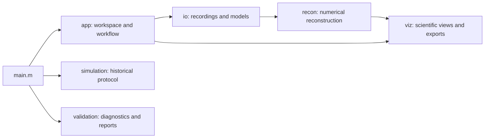

# SS-DOT GUI

A MATLAB application for short-separation diffuse optical tomography (SS-DOT), based on [Gao et al. (2023)](https://doi.org/10.1117/1.NPh.10.2.025007) and the [original SS-DOT implementation](https://github.com/YuanyuanGao216/SSDOT).

Load processed fNIRS recordings, reconstruct HbO/HbR maps, inspect signals and sensitivity, compare ROIs, and export results from one workspace.

## Requirements

- MATLAB R2026b is the documented runtime.
- Parallel Computing Toolbox and a compatible GPU are optional for GPU execution. CPU is the default.
- Signal Processing Toolbox is needed for filtering and motion-correction workflows.
- Optional external-data validation uses Python with NumPy, SciPy and h5py. The GUI itself does not require Python.

Bundled Homer dependencies are initialized automatically.

## Getting started

Open the repository folder in MATLAB and run:

```matlab
app = main();              % equivalent to main("gui")
```

1. Click **Open dataset...** and select the included `ST001` folder or another compatible dataset. Opening reads the stored Homer results and shows an **Overview** of recordings, durations, channels, wavelengths, conditions and model files. Nothing is computed.
2. Optionally review **Settings** and choose the profile, compute device and whether to run all recordings or only the shown one.
3. Press **Run Analysis**. For each recording it checks the inputs, prepares sensitivity, temporal and spatial bases, reconstructs HbO/HbR and calculates the ROI for every condition. Progress and the current step are shown in the Analysis panel; **Cancel** stops at the next safe boundary and keeps completed recordings.
4. Explore **Results** (HbO/HbR maps), **ROI**, **Signals**, **Model** and **Average**. Selecting a recording or condition only changes the display.

| Tab | Contents |
| --- | --- |
| Overview | Dataset summary, model-input readiness and the status of each recording |
| Signals | Stored raw intensity and optical density, with stored averages when available |
| Results | HbO/HbR maps by condition, with provenance and color scale |
| ROI | Automatic ROIs from Run Analysis, imported ROIs, comparisons and coordinate distances |
| Model | Registered probe, sensitivity, kernel centers and temporal basis |
| Average | Arithmetic mean of completed recordings with matching settings |
| Settings | Reconstruction parameters, model-input locations, ROI thresholds and figure export options |
| Log | Stage timings, activity log, technical error details and GPU check |

Settings apply to the whole workspace. Changing them never discards results: existing results are marked **Out of date** until the next Run Analysis, which reuses every result whose inputs and settings are unchanged. ROI thresholds can be changed after a run; **Update ROIs** recalculates them from existing results without repeating the reconstruction. An empty ROI (no vertex above the threshold) is a valid outcome and is reported as such.

## Dataset requirements

The GUI expects processed Homer data and a matching AtlasViewer/forward model. Raw SNIRF files alone are insufficient. A typical dataset contains:

```text
dataset/
├── atlasViewer.mat
├── fw/
│   ├── Adot.mat
│   └── Adot_scalp.mat
├── derivatives/
│   └── homer/
│       ├── groupResults.mat
│       └── ... associated processed run files
└── sess01/
    └── ... raw SNIRF recordings
```

Reconstruction requires continuous optical density, channel-activity metadata, task events, two wavelengths, and usable short-separation channels. Recording channels, wavelengths, probe coordinates, units and mesh ordering must match the forward model. Model discovery validates compatibility; it does not perform registration or substitute models from another dataset.

Use `SSDOT_DATA_ROOT` to change the default dataset browser location. Atlas and forward-model locations can also be selected in **Settings > Model inputs**; Run Analysis stays disabled, with the missing files listed, until they exist.

## Reconstruction

**Research** uses full configured resolution. The optional coarse **Preview** profile is intended for diagnostics. Scientific parameters remain explicit and should be selected for the acquisition and study.

The reconstruction backend uses exact temporal QR compression to avoid materializing the expanded design matrix. It retains double precision and the configured regularization objective without reducing spatial resolution. A dense reference backend is also available.

The default `professorOriginal` temporal mode uses onset impulses and configured-duration gamma smoothing. `durationBased` provides event-duration spreading as an alternative. Recorded event durations remain unchanged. Current defaults are defined in [defaultConfig.m](src/+ssdot/+app/defaultConfig.m); temporal compatibility does not imply that every application setting matches the original paper's protocol.

## ROI and exports

Run Analysis calculates one automatic ROI per condition with the existing `findRoi` rule on HbO: vertices above a fraction of the peak over the whole forward mesh that also lie in the brain sensitivity mask, plus a separate non-ROI set below a second fraction and outside an exclusion distance. The ROI viewer also supports imported ROIs and compatible side-by-side or overlay comparisons. ROIs belong to a specific mesh; forward-model and full-pial indices are not interchangeable. Coordinate distances use the selected mesh's frame and units.

**Export figures...** saves available maps, temporal bases, kernel centers and ROI views. PNG is the default; PDF and editable MATLAB FIG formats are available under **Settings > Figure export**. Raw/OD and probe/sensitivity views are optional. Exports use a new destination subfolder, never overwrite files and preserve the underlying numerical values. **Save session...** stores the shown recording's result, settings and ROIs; **Open session...** restores it for the matching recording and adopts its settings.

Generated caches, logs, reports and sessions are stored under ignored `results/`. Owned caches, temporary files and inactive logs have cleanup policies; deliberate exports, saved sessions and scientific reports are retained. Original dataset files are not modified.

## Architecture



| Location | Purpose |
| --- | --- |
| `src/+ssdot/+app` | Workspace window, explicit analysis workflow and per-recording state |
| `src/+ssdot/+io` | Dataset/model adapters, ROI and session persistence |
| `src/+ssdot/+recon` | Numerical functions with explicit inputs and outputs |
| `src/+ssdot/+viz` | Shared plotting and figure export |
| `src/+ssdot/+simulation` | Synthetic data and historical simulation workflows |
| `src/+ssdot/+validation` | Numerical diagnostics and validation reporting |
| `external/homer` | Bundled Homer/SNIRF dependencies |
| `research` | Research scripts and original-code comparison utilities |
| `tests` | Numerical, integration and GUI regression checks |

`main.m` is the single root-level MATLAB entry point. Individual package functions can also be called by adding `src` to the MATLAB path.

## Simulation and validation

```matlab
main("simulation")         % requires a configured simulation input bundle
main("validation")         % runs the validation/reporting workflow
```

Historical simulation requires separately supplied compatible reference recordings, resting data, forward models and stimulus sequences. Set `SSDOT_SIMULATION_INPUT_ROOT` or pass explicit paths to `ssdot.simulation.runStudy(options)`. The included experimental dataset is not a replacement for these inputs.

`main("validation")` runs the research reporting workflow (ST001 diagnostics, known-source simulations and optional public benchmarks); it is intentionally not part of the analysis workspace. Reports use HTML with MAT/CSV/JSON numerical outputs. External recordings require compatible models and their own usage permissions; keep downloaded datasets outside Git. Numerical agreement is distinct from physiological or anatomical validation.

## Development

Run the checks relevant to a change. To run the complete suite:

```matlab
results = runtests("tests", "IncludeSubfolders", true);
assertSuccess(results);
assert(all([results.Passed]));
```

Some tests require external recordings listed in [publicDataManifest.json](tests/fixtures/publicDataManifest.json); they are read from `SSDOT_PUBLIC_DATA_ROOT`, or from `ssdot-public-data-audit` in the temporary folder, and verified by checksum. GPU tests require the corresponding toolbox and hardware. The full-resolution workflow test is reported as not executed when the memory preflight finds too little free RAM. GUI tests replace `app.controller.chooser` instead of driving native file dialogs.

## Reference and license

Gao, Y. et al. (2023). *Short-separation regression incorporated diffuse optical tomography image reconstruction modeling for high-density functional near-infrared spectroscopy.* Neurophotonics, 10(2), 025007. [Paper](https://doi.org/10.1117/1.NPh.10.2.025007) · [Original code](https://github.com/YuanyuanGao216/SSDOT).

SS-DOT is distributed under the [MIT license](LICENSE), copyright © 2022 Yuanyuan Gao. This GUI builds on the original research implementation and subsequent student contributions.

Bundled Homer and [SNIRF](https://github.com/fNIRS/snirf_homer3) code retains its own copyright and redistribution notices, including those in [GetExtinctions.m](external/homer/HomerClass_ForOutPut/FuncRegistry/UserFunctions/GetExtinctions.m) and [MakeFilter.m](external/homer/HomerClass_ForOutPut/FuncRegistry/UserFunctions/MakeFilter.m). Those dependency terms remain applicable independently of the project license.
